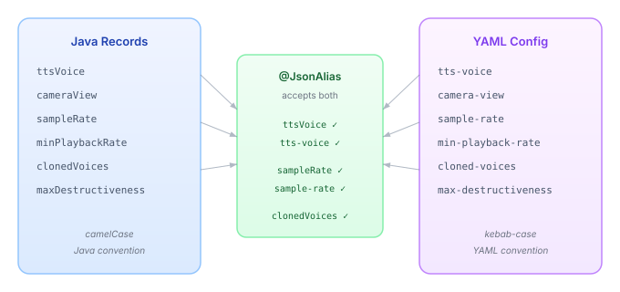
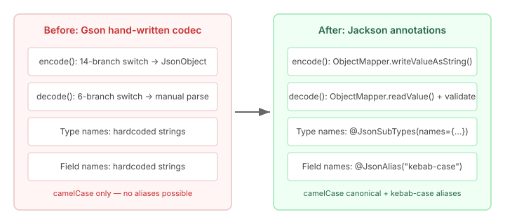

# The Config Your Fingers Expect

The design spec for the avatar YAML showed kebab-case properties — `tts-voice`, `camera-view`, `sample-rate`. The actual Java records accepted only camelCase. The spec was aspirational; the code was literal. Anyone who wrote the YAML the way the spec showed it would get an `UnrecognizedPropertyException` and no explanation of what went wrong.

This is a small gap, but it's a common one, and the fix is worth talking about because the obvious answer is wrong.

## The obvious wrong answer

The first instinct is to change `@JsonProperty("ttsVoice")` to `@JsonProperty("tts-voice")`. That's what the YAML should look like, so make the code match. But `@JsonProperty` does two things: it names the property for deserialization *and* for serialization. Change it to `tts-voice` and every existing consumer that reads `ttsVoice` from JSON responses breaks. Worse, the Java accessor is still `ttsVoice()` — the record component name doesn't change — so the serialized output and the accessor would disagree about what the field is called.

The other wrong answer is `PropertyNamingStrategies.KEBAB_CASE` on the ObjectMapper. That converts *all* property names, including ones that are already single words. It also applies globally — you'd need a separate ObjectMapper or mixin for every record that mixes single-word and multi-word properties. And it makes the camelCase form stop working, breaking existing YAML files.

## The right answer: aliases, not renames



Jackson's `@JsonAlias` accepts alternative names for deserialization without changing the canonical property name. The canonical name stays camelCase (what `@JsonProperty` declares, what `ttsVoice()` returns, what serialization produces). The alias adds kebab-case as an accepted input. Both forms work. Nothing breaks.

The pattern looks like this:

```java
@JsonProperty("ttsVoice") @JsonAlias("tts-voice")
@Nullable String ttsVoice,

@JsonProperty("sampleRate") @JsonAlias("sample-rate")
@Nullable Integer sampleRate,
```

For records without a `@JsonCreator` factory, `@JsonAlias` goes on the record component directly:

```java
public record TtsEngineSpec(
        String type,
        List<TtsVoiceSpec> voices,
        @JsonAlias("cloned-voices") @Nullable List<String> clonedVoices) {
```

## Scaling from three records to fifty-seven

The first pass touched three records — `AvatarDefinition`, `TtsEngineSpec`, `CleanupConfigSpec` — six properties in total. That was enough to validate the pattern. But the same gap existed across every spec record in the agentic-yaml module. `failurePolicy` on every `PatternDefinition` variant. `convergenceThreshold` on `TopologySpec.Distributed`. `minSignalsForInference` on `MentalModelConfigSpec`. Two hundred and forty-two multi-word camelCase fields across fifty-seven files, each one a potential `UnrecognizedPropertyException` waiting for someone writing kebab-case YAML.

Doing this by hand would be tedious and error-prone. The conversion itself is mechanical — `camelCase` to `kebab-case` follows a deterministic rule — so I wrote a Python script to scan every record in the spec directory, identify multi-word camelCase components, and insert the annotation. The script handles three cases: bare record components (`@JsonAlias("kebab") Type field`), components with `@Nullable` (annotation goes before `@Nullable`), and components with `@JsonProperty` (annotation goes after it).

## When aliases collide

One record threw a curveball. `CognitionDefinition` already had a `@JsonAlias` on the personality field — not for kebab-case, but as a semantic shorthand:

```java
@JsonProperty("personalityEvolution") @JsonAlias("personality")
@Nullable PersonalityEvolutionConfigSpec personality,
```

The YAML key is `personalityEvolution`. The existing alias `personality` lets authors skip the `Evolution` suffix. The kebab form `personality-evolution` needs to be a *second* alias, not a replacement. Jackson supports this with the array form:

```java
@JsonProperty("personalityEvolution")
@JsonAlias({"personality", "personality-evolution"})
@Nullable PersonalityEvolutionConfigSpec personality,
```

Now all three names resolve to the same field — the canonical `personalityEvolution`, the semantic shorthand `personality`, and the kebab-case `personality-evolution`. Each serves a different audience: serialization, brevity, convention.

This is the general principle at work. `@JsonAlias` is additive. It doesn't rename or replace — it widens the set of names that resolve to a field. When a third convention arrives, another alias costs one annotation.

## From config files to wire protocols

The same pattern applies beyond YAML config. The avatar's WebSocket protocol uses JSON messages with a `type` discriminator — `playbackComplete`, `turnComplete`, `userActivity` — and multi-word fields like `sampleRate`, `llmModel`, `turnSeq`. Originally this was a hand-written Gson codec: 130 lines of `switch` statements building `JsonObject` instances field by field, with a mirrored decode path parsing each type manually. It worked, but it couldn't support aliases at all — Gson has no equivalent of `@JsonAlias`.



Migrating to Jackson replaced 130 lines of manual codec with `ObjectMapper.writeValueAsString()` and `ObjectMapper.readValue()`. The sealed `AvatarMessage` hierarchy gets `@JsonTypeInfo` and `@JsonSubTypes` — Jackson handles the `type` discriminator automatically. The interesting part is that `@JsonSubTypes.Type` supports a `names` array (Jackson 2.12+) where the first entry is the canonical serialization name and subsequent entries are deserialization aliases:

```java
@JsonSubTypes.Type(value = PlaybackComplete.class,
    names = {"playbackComplete", "playback-complete"}),
@JsonSubTypes.Type(value = UserActivity.class,
    names = {"userActivity", "user-activity"})
```

This means the same alias-not-rename principle applies to type discriminators, not just field names. The server always writes `"type":"playbackComplete"` — existing clients don't see a change. But a polyglot client can send `"type":"playback-complete"` and it resolves to the same type.

One subtlety caught by the code review: the old Gson codec omitted null fields from the wire output. Jackson serializes all record components by default, including nulls. A `Start` message with no explicit model selection would suddenly grow `"llmModel":null,"ttsModel":null` in the output — technically backward-compatible but noisy and potentially surprising for clients checking `"llmModel" in msg`. The fix is `@JsonInclude(NON_NULL)` on the records with nullable fields, which restores the old codec's behaviour of only including fields that have values.

## The broader principle

Config surfaces, wire protocols, and API payloads all share the same tension: the Java side uses camelCase because that's what identifiers do, and everyone else expects their own convention — kebab-case for YAML, potentially kebab-case or snake_case for JSON. Neither audience is wrong. The serialization layer's job is to bridge the gap without forcing either side to adopt the other's convention.

The alternative — picking one convention and forcing everyone to use it — always trades one audience's comfort for another's confusion. Aliases avoid the trade entirely. And because `@JsonAlias` works identically on YAML config records, WebSocket protocol DTOs, and REST API payloads, the same one-line annotation covers every surface.
